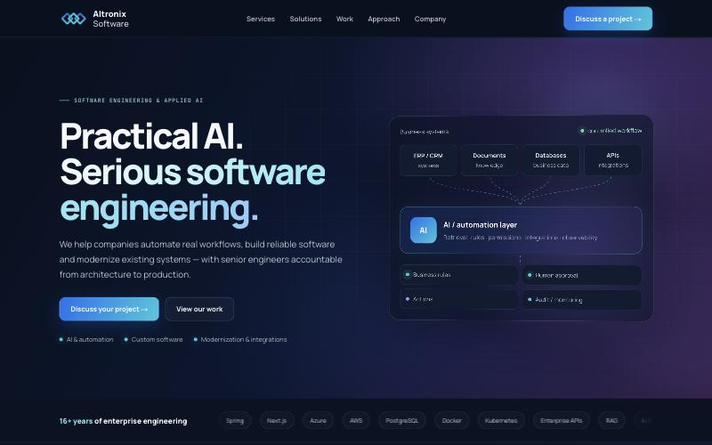
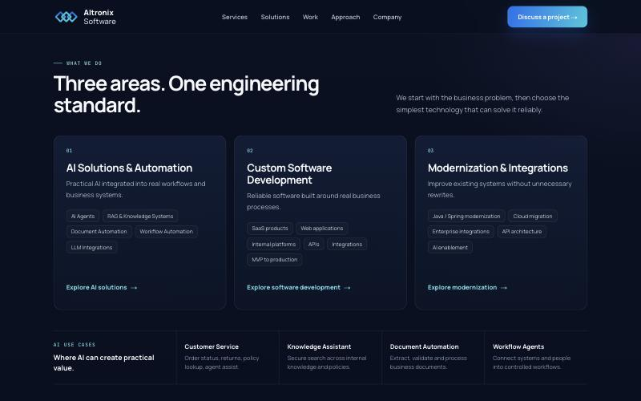
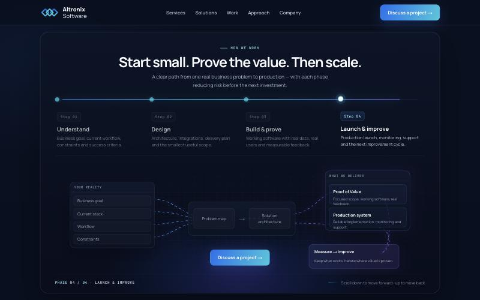
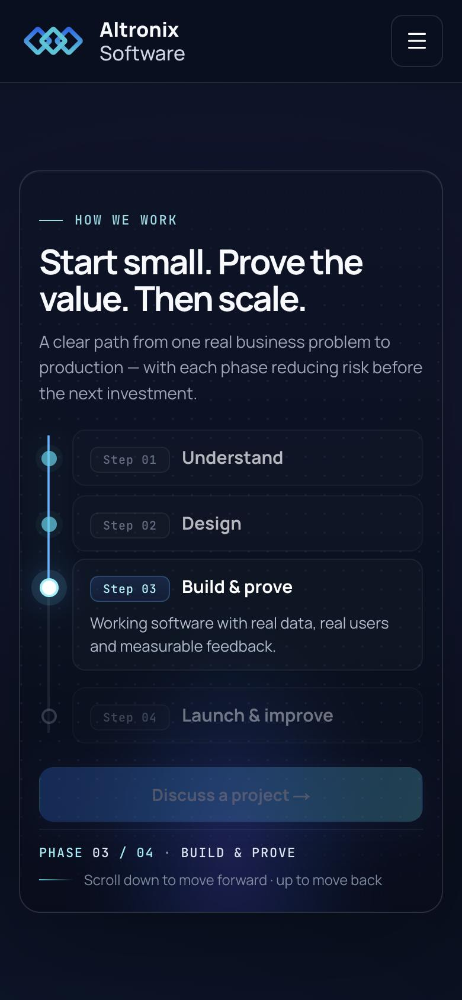
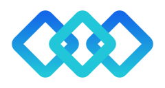

<div align="center">



<br />


**The corporate website of [Altronix Software](https://altronixsoft.com) — a focused, senior-led engineering studio.**
<br />
AI solutions & automation · custom software · modernization & integrations.

[Screens](#-screens) · [Highlights](#-highlights) · [Design system](#-design-system) · [Stack](#-stack) · [Structure](#-project-structure) · [Getting started](#-getting-started) · [Before launch](#-before-launch)

</div>

<br />

## 🖥 Screens

<div align="center">
  
  <sub><b>Hero</b> — business systems, an AI / automation layer, and controlled actions (rules · approval · actions · audit).</sub>
</div>

<br />

<div align="center">
  
  <sub><b>Services</b> — three areas, one engineering standard, with a deliberately quiet AI use-case strip.</sub>
</div>

<br />

<table>
  <tr>
    <td width="68%" valign="top" align="center">
      
      <sub><b>Process journey</b> — scroll-driven, fully reversible. Shown at phase 4 · Launch &amp; improve.</sub>
    </td>
    <td width="32%" valign="top" align="center">
      
      <sub><b>Mobile</b> — vertical timeline.</sub>
    </td>
  </tr>
</table>

<br />

## ✨ Highlights

- **Scroll-driven process journey.** A sticky section where scroll position drives four phases — *Understand → Design → Build & prove → Launch & improve*. The progress line (blue → cyan → violet), the phase states and the workflow map all follow one value, so scrolling back up reverses everything naturally. Isolated in a single component: [`ProcessJourney.tsx`](src/components/home/ProcessJourney.tsx).
- **Enterprise-architecture hero visual.** Animated connectors, staggered node reveals, status pulses and a barely-there pointer tilt — restrained on purpose.
- **Commercial work and Labs kept apart.** Anonymous client projects (role · environment · focus) versus a clearly labelled *Altronix Labs* block. No invented customers, metrics or testimonials.
- **Premium but quiet motion.** Section reveals, pointer-following card glow, a subtle capability marquee, and a slight parallax on the large background glows only. Everything respects `prefers-reduced-motion`.
- **Built for every screen.** Desktop, laptop-height viewports (the process section adapts so nothing is clipped), tablet, and phone — with horizontal snap-scrolling rows instead of endless card stacks.
- **Accessible by default.** Semantic landmarks, a keyboard-operable mobile drawer (focus trap, `Esc`, focus return), visible focus rings, `aria-current` on the active phase, skip link, 44px tap targets.
- **SEO ready.** Metadata API, Open Graph & Twitter tags, canonical, `robots` + `sitemap`, and JSON-LD (`Organization`, `ProfessionalService`) with no made-up addresses or ratings.

<br />

## 🎨 Design system

Deep navy (~70%), indigo surfaces (~20%), cyan / violet ambient light (~10%) — localized radial glows, never full-width gradient walls. Tokens live in [`globals.css`](src/app/globals.css) as CSS variables and are exposed to Tailwind.

| Token | Value | Use |
| --- | --- | --- |
| `--background` |  `#07101f` | Page background |
| `--surface` / `--surface-raised` |  `#0f1a30` ·  `#121f39` | Cards, panels |
| `--blue` |  `#1670ef` | Primary actions |
| `--cyan` |  `#25c8dd` | Active states, links |
| `--indigo` / `--violet` |  `#4548a8` ·  `#7d67d9` | Ambient light |
| `--text-primary` / `--text-secondary` | `#f7f9fc` · `#a7b2c5` | Text |

**Type:** [Manrope](https://fonts.google.com/specimen/Manrope) for everything; [JetBrains Mono](https://www.jetbrains.com/lp/mono/) only for technical labels (numbers, status, eyebrows).

<br />

## 🧱 Stack

| | |
| --- | --- |
| **Framework** | Next.js (App Router), React, Server Components by default |
| **Language** | TypeScript, `strict` mode, no `any` |
| **Styling** | Tailwind CSS v4 + CSS variables; CSS Modules for the two bespoke visuals |
| **Icons** | `lucide-react` |
| **Animation** | CSS-first — no animation library |
| **Hosting** | Static output, deployable to Vercel as-is — no backend |

Client components are limited to what genuinely needs the browser: `Header` (drawer), `AnimatedReveal`, `SpotlightCard`, `TiltCard`, `HeroGlows`, `ProcessJourney`.

<br />

## 📁 Project structure

```text
src/
├─ app/                    layout, page, metadata, robots, sitemap, icon, globals.css (tokens)
├─ components/
│  ├─ layout/              Header (sticky + accessible drawer), Footer, Logo
│  ├─ home/                Hero, TrustStrip, Services, AiUseCases, SelectedWork,
│  │                       ProcessJourney, Company, FinalCTA
│  ├─ ui/                  Button, Container, Section, SectionHeading, Tag,
│  │                       AnimatedReveal, SpotlightCard, CardRow, ImagePlaceholder
│  └─ JsonLd.tsx           structured data
├─ data/                   all copy & content as typed arrays
│                          (services, projects, process, company, navigation, site)
└─ lib/utils.ts
docs/                      README assets (banner, logo, screenshots)
reference/                 the approved HTML prototype, kept for visual comparison
```

<br />

## 🚀 Getting started

```bash
npm install
npm run dev       # http://localhost:3000
```

```bash
npm run build     # production build
npm run start     # serve the production build
npm run lint
```

Requires Node.js 20+.

<br />

## ✅ Before launch

- [ ] Set `NEXT_PUBLIC_SITE_URL` (canonical / Open Graph base — defaults to `https://altronixsoft.com`).
- [ ] Add the founder photo: pass `src` to `<ImagePlaceholder>` in [`Company.tsx`](src/components/home/Company.tsx) and drop the file into `public/`.
- [ ] Confirm the role / environment / focus wording of the commercial projects in [`src/data/projects.ts`](src/data/projects.ts).
- [ ] Optional: add an `opengraph-image` for richer link previews.

All calls to action are `mailto:` links to `info@altronixsoft.com` until a contact backend exists.

<br />

<div align="center">
  
  <br />
  <sub>© Altronixsoft OÜ · <i>Practical AI. Serious software engineering.</i></sub>
</div>
